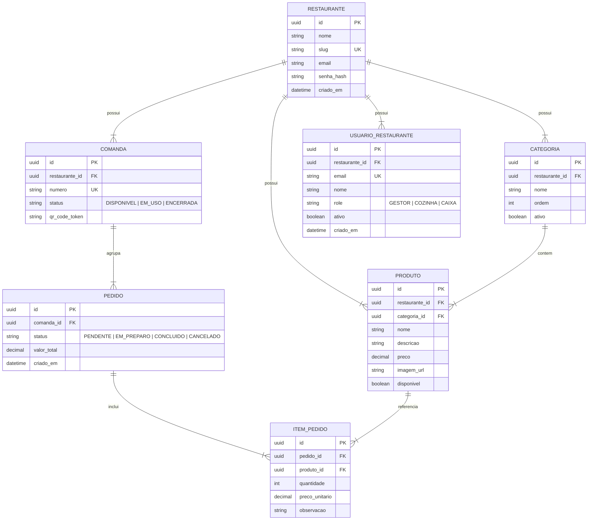

# PRD: Sistema de Cardápio Digital & Comandas QR Code

## 1. Visão Geral do Produto & Objetivos

### 1.1 Sumário Executivo
O **Sistema de Cardápio Digital & Comandas QR Code** é uma plataforma SaaS voltada para restaurantes, bares e estabelecimentos gastronômicos. Ele elimina gargalos operacionais e reduz o tempo de espera dos clientes ao transformar a experiência de pedido em mesa em um fluxo 100% digital, sem atrito e sem necessidade de download de aplicativo ou cadastro.

### 1.2 Objetivos de Negócio & Métricas de Sucesso
- **Redução do Tempo de Atendimento:** Diminuir em até 60% o tempo entre a chegada do cliente e o envio do primeiro pedido para a cozinha.
- **Aumento do Ticket Médio:** Estimulado por um cardápio interativo com fotos de alta qualidade e facilidade de adição de itens adicionais.
- **Zero Erros de Transcrição:** Pedidos enviados diretamente do smartphone do cliente para a tela da cozinha (KDS).
- **Métrica Contraditória (Counter-Metric):** Garantir que a automação digital não aumente a taxa de cancelamentos por pedidos acidentais (deve permanecer abaixo de 1.5%).

---

## 2. Jornadas do Usuário (User Journeys)

### UJ-1: Lucas (Cliente do Restaurante) - Pedido na Mesa sem Cadastro
1. Lucas chega ao restaurante com amigos e senta em uma mesa que possui uma **comanda física com QR Code**.
2. Lucas aponta a câmera do celular para o QR Code (URL: `app.restaurante.com/seu-bar/comanda/015`).
3. O navegador abre diretamente no cardápio do restaurante com a **Comanda #015** atrelada.
4. Lucas navega pelas categorias (*Bebidas*, *Entradas*, *Pratos Principais*), seleciona 2 hambúrgueres e 2 sucos, e clica em **Ver Carrinho**.
5. Lucas revisa a lista de itens, o valor total parcial e clica em **Finalizar Pedido**.
6. O sistema exibe a confirmação: "Pedido #104 enviado para a cozinha!".

### UJ-2: Chef Carlos (Cozinheiro) - Operação KDS na Cozinha
1. Carlos monitora a tela sensível ao toque ou monitor da cozinha (Módulo KDS).
2. Toca um sinal sonoro suave e aparece o **Pedido #104** (Comanda #015) na coluna **Pendentes**.
3. Carlos analisa os itens (2 hambúrgueres ao ponto), clica em **Iniciar Preparo**.
4. O Pedido #104 se move automaticamente para a coluna **Em Preparo**.
5. Quando os hambúrgueres ficam prontos, Carlos clica em **Concluir**.
6. O pedido vai para a aba **Concluídos** e o garçom/passador leva os pratos para a mesa referente à Comanda #015.

### UJ-3: Ana (Atendente do Caixa) - Fechamento de Conta e Liberação
1. Lucas e os amigos se dirigem ao balcão e entregam a comanda física #015 para Ana.
2. Ana digita "015" no terminal do Caixa.
3. O sistema exibe o histórico consolidado de consumo da Comanda #015 (todos os pedidos realizados durante a permanência na mesa).
4. Ana informa o total ao cliente, recebe o pagamento (Dinheiro/Cartão/Pix) e clica em **Fechar Comanda & Concluir Pagamento**.
5. O sistema registra o fechamento, zera o consumo da Comanda #015 e altera seu status para **Liberada/Disponível**.

### UJ-4: João (Dono / Gestor do Restaurante) - Gestão Operacional & Equipe
1. João faz login com e-mail e senha no painel administrativo (`/admin` ou `/login`).
2. João acessa a aba **Equipe / Usuários** e cadastra dois colaboradores:
   - **Pedro:** E-mail `pedro.cozinha@sabor.com`, Perfil **COZINHA**.
   - **Maria:** E-mail `maria.caixa@sabor.com`, Perfil **CAIXA**.
3. O sistema cria os acessos atrelados estritamente ao `restaurante_id` do João.

### UJ-5: Pedro (Cozinheiro) - Acesso Operacional Exclusivo ao KDS
1. Pedro chega para seu turno na cozinha e acessa a tela de login.
2. Pedro insere suas credenciais (`pedro.cozinha@sabor.com` / senha).
3. O sistema autentica Pedro, identifica seu papel `COZINHA` e o redireciona automaticamente para o Kanban da Cozinha (`/cozinha`).
4. Pedro visualiza em tempo real **apenas** os pedidos das comandas do restaurante do João.
5. Se Pedro tentar digitar manualmente na barra de endereço `/admin` ou `/caixa`, o sistema bloqueia o acesso por restrição de perfil (RBAC) e o mantém seguro no KDS.

### UJ-6: Maria (Operadora de Caixa) - Acesso Operacional Exclusivo ao POS
1. Maria abre o navegador no terminal do caixa e faz login com suas credenciais (`maria.caixa@sabor.com` / senha).
2. O sistema detecta o papel `CAIXA` e a redireciona imediatamente para o terminal de checkout (`/caixa`).
3. Maria busca as comandas abertas, confere extratos e registra pagamentos **exclusivamente** das comandas do restaurante do João.
4. Se Maria tentar acessar `/admin` ou `/cozinha`, o sistema impede o acesso não autorizado.

---

## 3. Requisitos Funcionais (FRs)

### 3.1 Módulo Cliente & Cardápio Digital (Public Frontend)
- **FR-101:** O sistema deve permitir o acesso ao cardápio digital via URL com parâmetro dinâmico da comanda sem exigir login/cadastro.
- **FR-102:** O sistema deve exibir as categorias de produtos de forma organizada e navegável (tab-bar ou filtro rápido).
- **FR-103:** Cada item do cardápio deve exibir título, descrição, foto, preço e indicador de disponibilidade.
- **FR-104:** O cliente deve ser capaz de adicionar itens ao carrinho, ajustar quantidades e incluir observações por item.
- **FR-105:** O sistema deve disponibilizar uma tela de revisão do carrinho com botão explícito de "Confirmar e Enviar Pedido".
- **FR-106:** Após a confirmação, o pedido deve ser gravado no banco atrelado à comanda e ao restaurante correspondente.

### 3.2 Módulo Cozinha / KDS (Kitchen Display System)
- **FR-201:** O sistema deve exibir os pedidos recebidos em tempo real organizados em colunas por status (`Pendente`, `Em Preparo`, `Concluído`).
- **FR-202:** O sistema deve emitir um alerta sonoro e visual configurável a cada novo pedido na coluna `Pendente`.
- **FR-203:** O cozinheiro deve ser capaz de alterar o status de um pedido de `Pendente` para `Em Preparo`.
- **FR-204:** O cozinheiro deve ser capaz de alterar o status de um pedido de `Em Preparo` para `Concluído`.
- **FR-205:** O KDS deve destacar há quanto tempo o pedido está aguardando (cronômetro de espera).

### 3.3 Módulo Caixa / Atendimento (POS)
- **FR-301:** O atendente deve conseguir buscar uma comanda ativa digitando seu número no sistema.
- **FR-302:** O sistema deve listar todos os pedidos e itens consumidos atrelados àquela comanda, com o valor total calculated.
- **FR-303:** O sistema deve permitir realizar o fechamento da comanda, marcando-a como paga e alterando seu status para `Disponível`.
- **FR-304:** A limpeza da comanda não pode apagar o histórico de vendas do restaurante (dados mantidos para auditoria e relatórios).

### 3.4 Módulo Administrativo & Dono do Restaurante (Gestor)
- **FR-401:** Autenticação de gestores via e-mail e senha com suporte a multi-tenant (múltiplos restaurantes isolados).
- **FR-402:** Gerenciamento de Categorias (Criar, Editar, Reordenar, Desativar, Excluir).
- **FR-403:** Gerenciamento de Produtos (Criar, Editar preço/foto/descrição, Marcar como esgotado, Excluir).
- **FR-404:** Geração Automática de Comandas com números sequenciais ou personalizados.
- **FR-405:** Disponibilização de gerador de QR Code individualizado por comanda para salvar/imprimir.
- **FR-406:** Exibição do link exclusivo do cardápio digital do restaurante (`app.restaurante.com/[slug_restaurante]`).

### 3.5 Módulo de Gestão de Equipe & Controle de Acesso por Perfil (RBAC Multi-Tenant)
- **FR-501:** O gestor do restaurante deve conseguir cadastrar membros de equipe vinculados ao seu `restaurante_id` (campos: Nome, E-mail, Senha e Papel: `COZINHA` ou `CAIXA`).
- **FR-502:** O gestor deve ser capaz de listar, editar dados e ativar/desativar o acesso de qualquer usuário da sua equipe.
- **FR-503:** O sistema de login unificado deve autenticar o usuário e identificar automaticamente seu perfil (`GESTOR`, `COZINHA`, `CAIXA`) e o `restaurante_id` correspondente.
- **FR-504:** Roteamento e restrições de tela baseados no perfil:
  - Usuários com perfil `COZINHA` são redirecionados pós-login diretamente para `/cozinha` e bloqueados de acessar `/admin` ou `/caixa`.
  - Usuários com perfil `CAIXA` são redirecionados pós-login diretamente para `/caixa` e bloqueados de acessar `/admin` ou `/cozinha`.
  - Usuários com perfil `GESTOR` possuem acesso amplo e irrestrito ao `/admin`, `/caixa`, `/cozinha` e gestão de equipe.
- **FR-505:** Isolamento de dados multi-tenant estrito: qualquer listagem, consulta ou subscrição em tempo real de pedidos, comandas, produtos e relatórios deve filtrar exclusivamente pelo `restaurante_id` da conta autenticada, sendo estritamente proibido qualquer vazamento ou cruzamento de informações entre diferentes estabelecimentos.

---

## 4. Requisitos Não-Funcionais (NFRs)

- **NFR-001 (Desempenho):** O tempo de carregamento inicial do cardápio digital no smartphone do cliente deve ser menor que 1.5 segundos em rede 4G.
- **NFR-002 (Tempo Real):** O envio do pedido pelo cliente deve ser refletido na tela da cozinha (KDS) em menos de 1 segundo.
- **NFR-003 (Responsividade):** A interface do cliente deve ser 100% responsiva para telas móveis (320px a 430px de largura). O painel da cozinha deve ser otimizado para monitores Full HD e tablets.
- **NFR-004 (Disponibilidade):** O sistema deve operar com disponibilidade mínima de 99.9% (SLA de restaurante em operação).
- **NFR-005 (Segurança):** Impede inserção de pedidos em comandas que estejam com status `Encerrada/Inativa`. Sanitização contra injeções SQL e XSS.
- **NFR-006 (Isolamento Multi-Tenant & RBAC):** Proibição categórica de vazamento de dados entre tenants. Cada consulta de API, token JWT e canal de WebSocket deve validar o `restaurante_id` antes de expor ou modificar dados.

---

## 5. Modelo de Dados Relacional (Modelo Lógico)

---

## 6. Próximos Passos no Ciclo BMad

- **`bmad-ux`:** Desenhar o wireframe e protótipo das telas principais.
- **`bmad-architecture`:** Definir a pilha de tecnologias (Vite/React ou Next.js + Tailwind CSS + Supabase/Node.js).
- **`bmad-create-epics-and-stories`:** Quebrar este PRD em Épicos e Histórias de Usuário testáveis.
