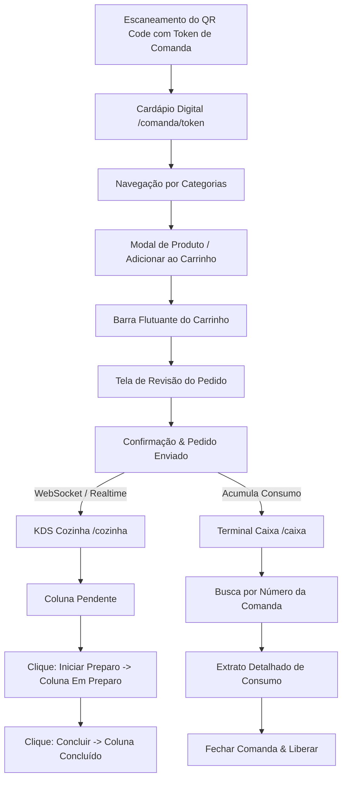

# EXPERIENCE.md - Arquitetura de Informação e Padrões de Interação

## 1. Fundação & Módulos da Aplicação (Foundation)

O sistema é composto por 4 visões distintas adaptadas para cada dispositivo e usuário:

1. **Cardápio Digital do Cliente (`/comanda/[token]`)**
   - Dispositivo: Smartphone do cliente (iOS / Android Web Browser).
   - Foco: Navegação ultra-rápida, fotos de pratos, adição ao carrinho e envio do pedido sem cadastro.
2. **KDS da Cozinha (`/cozinha`)**
   - Dispositivo: Tablet ou Monitor Touchscreen na cozinha (Modo Dark).
   - Foco: Alta visibilidade, tempo de espera, botões rápidos de alteração de status (`Pendente` -> `Em Preparo` -> `Concluído`).
3. **Terminal do Caixa (`/caixa`)**
   - Dispositivo: Desktop / Tablet no balcão.
   - Foco: Busca por número de comanda, conferência de consumo, recebimento do pagamento e liberação da comanda.
4. **Painel do Gestor (`/admin`)**
   - Dispositivo: Desktop / Laptop.
   - Foco: Cadastro de categorias, pratos, preços, geração de comandas e QR Codes.

---

## 2. Arquitetura de Informação & Rotas (Information Architecture)

---

## 3. Padrões de Estado & Microcopia (State Patterns & Voice/Tone)

### 3.1 Estados do Cardápio do Cliente
- **Carrinho Vazio:** "Seu carrinho está vazio. Escolha pratos incríveis do nosso cardápio!"
- **Item Adicionado:** Toast temporário `✓ Hambúrguer adicionado ao carrinho!`.
- **Tela de Revisão:** "Revise seu pedido antes de enviar para a cozinha. Número da Comanda: #015."
- **Pedido Enviado:** Tela de sucesso com animação de check verde: "Seu pedido #104 foi enviado para a cozinha! Acompanhe o status nesta tela."

### 3.2 Estados do KDS da Cozinha
- **Nenhum Pedido Pendente:** "Cozinha sem pedidos pendentes no momento! 🍳"
- **Novo Pedido Chegando:** Card pisca com borda amarela `colors.status_pending` + Alerta Sonoro.
- **Pedido em Preparo:** Card fixado com borda azul `colors.status_preparing` e cronômetro ativo.

### 3.3 Estados do Caixa
- **Comanda não Encontrada:** "Nenhuma comanda ativa encontrada com o número informado."
- **Comanda Sem Consumo:** "Comanda #015 está limpa e disponível."
- **Comanda com Pedidos:** Exibição do total em negrito com divisão por hora e item.

---

## 4. Fluxos Detalhados de Interação (Key Flows)

### Flow 1: Cliente Fazendo Pedido na Mesa
1. **Entrada:** Cliente escaneia o QR Code `.../comanda/token-xyz`.
2. **Validação:** O sistema verifica se o token é válido. Se sim, carrega o cardápio com o banner `Mesa 05 | Comanda #015`.
3. **Seleção:** Cliente clica em no card do produto `Hambúrguer Gourmet`.
4. **Customização (Opcional):** Se houver observações, abre um modal de texto curto (ex: "Sem cebola").
5. **Carrinho:** Clique em `Adicionar (R$ 38,00)`. A barra inferior atualiza para `1 item — R$ 38,00`.
6. **Revisão:** Clique na barra inferior `Ver Carrinho`. Exibe lista de itens + botão `Finalizar Pedido`.
7. **Confirmação:** Clique em `Finalizar Pedido`. O pedido recebe um ID local e é emitido via evento para o backend.

### Flow 2: Cozinheiro Gerenciando a Fila (KDS)
1. **Visualização:** A tela `/cozinha` exibe 3 colunas (*Pendentes*, *Em Preparo*, *Concluídos*).
2. **Aceitação:** Ao clicar no botão amarelo `[ Iniciar Preparo ]` do Pedido #104, o card desliza suavemente para a coluna *Em Preparo*.
3. **Finalização:** Ao terminar de montar o prato, o cozinheiro toca no botão azul `[ Concluir ]`. O card vai para a coluna *Concluídos* (onde permanece por 5 minutos e depois é arquivado).

### Flow 3: Atendente Fechando a Comanda no Caixa
1. **Busca:** Atendente digita `15` no campo de busca do caixa e aperta `Enter`.
2. **Leitura:** O sistema puxa os Pedidos #101, #104 e #108 vinculados à Comanda #015.
3. **Conferência:** Atendente lê os itens e confirma o valor total de R$ 112,00.
4. **Fechamento:** Atendente clica em `[ Encerrar & Liberar Comanda ]`. O sistema registra o pagamento e zera a comanda #015 para o próximo cliente.

---

## 5. Acessibilidade & Responsividade

- **Tamanho dos Alvos de Toque (Touch Targets):** Todos os botões na visão do cliente e no KDS possuem altura mínima de `48px` para evitar cliques acidentais.
- **Contraste:** Texto escuro `#0F172A` em fundo claro `#FFFFFF` no cliente; texto claro `#FFFFFF` em fundo escuro `#0F172A` no KDS.
- **Navegação Sem Teclado / Touch-First:** O KDS funciona 100% com toques diretos na tela sem necessidade de mouse ou teclado.
